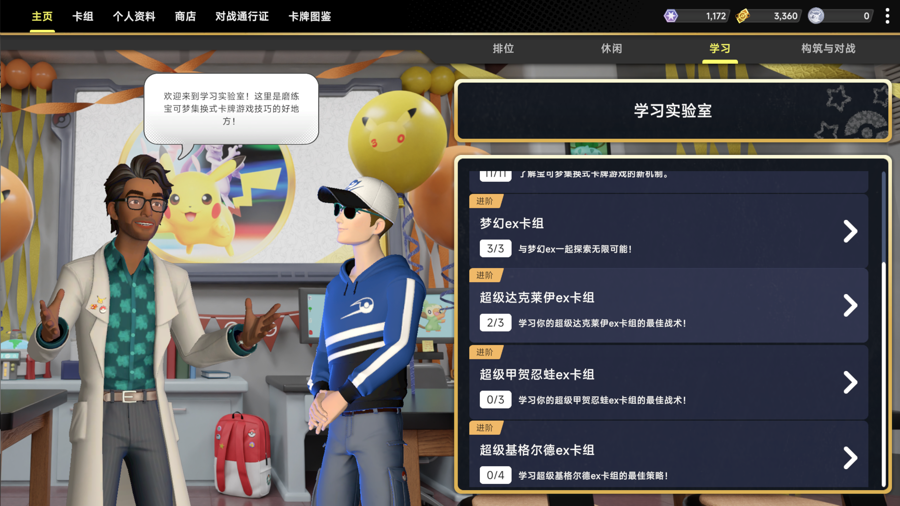
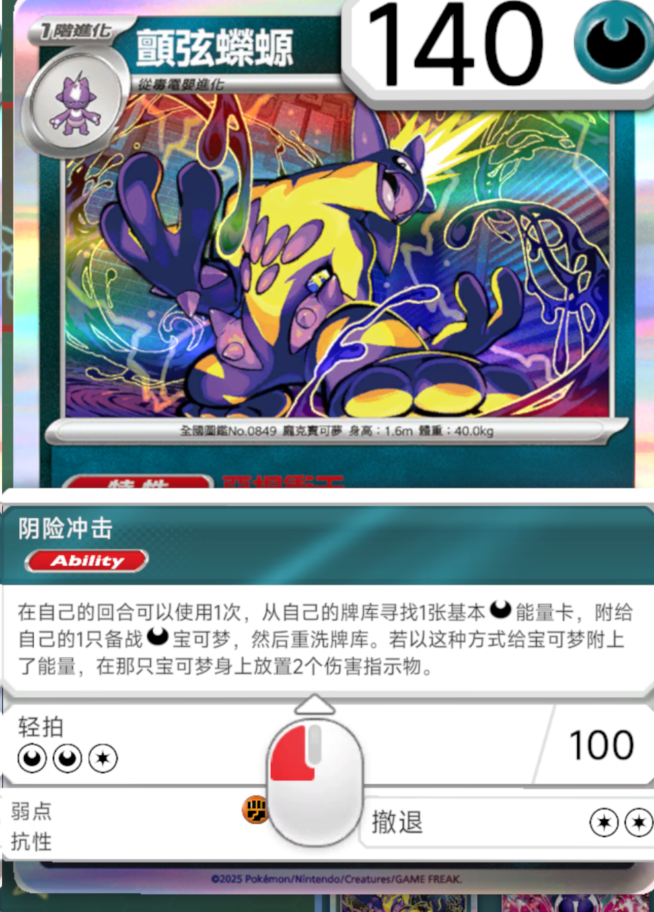

# PTCGLiveZhManager

Pokémon Trading Card Game Live 桌面版简体中文汉化。

由 **feilao** 在 [Hill-98/ptcg-live-zh-mod](https://github.com/Hill-98/ptcg-live-zh-mod) 的基础上继续完善，补充界面和卡牌译文，修正游戏中发现的漏翻与错译。感谢 Hill-98（小山）及原项目的所有贡献者。

**适用游戏版本：1.43.0 · 汉化版本：r0 · 基础包：b1**

## 汉化进度

**当前版本已收录的游戏文本：100%汉化。** 菜单、任务、商店、公告，以及卡牌名称、招式、特性和效果说明均已补齐。后续会跟随每个游戏版本更新，补充新增内容，并继续修正玩家反馈的漏翻和错译。

目前做的是**游戏内文本汉化**，**卡图汉化还没做，后续会继续补上**。卡面图片不计入文本进度，也不随当前汉化包提供。

## 这一版的特点

- **统一简体中文**：界面、卡名和效果说明统一用简体，清理繁简混用。
- **优先采用官方简中名称**：先参考官方简中卡面与资料；没有对应简中资料时，再参考官方繁中并转为简体，尽量让游戏里的叫法和实体卡一致。
- **补齐旧版遗漏**：新增一万多条文本，补充新版商店、学习教程和卡牌效果，修正已发现的错译。
- **更新只换汉化包**：Windows、Mac各装一次自己的基础包，之后共用同一份汉化更新包。

本分支继承的原版译文中，还有“深缽鎮”“奧琳博士的气魄”“棄世猴ex礼盒”等繁体或繁简混用写法。这一版已统一为“深钵镇”“奥琳博士的气魄”“弃世猴ex礼盒”。

## 游戏截图

学习界面：



卡牌名称与技能说明：




## 更新了多少文本

截至2026年10月10日，共收录 **26,984条文本**。原项目为 **15,527条**，本版新增 **11,457条**，另修订了 **7,081条已有译文**。

| 内容 | 原项目 | 本版 | 新增 |
| --- | ---: | ---: | ---: |
| 界面、任务、商店与公告 | 6,555 | 10,321 | 3,766 |
| 卡牌名称 | 3,189 | 3,380 | 191 |
| 招式与特性名称 | 2,997 | 6,918 | 3,921 |
| 卡牌效果与规则说明 | 2,786 | 6,365 | 3,579 |
| **合计** | **15,527** | **26,984** | **11,457** |

数量按文本条目统计，包含名称和整段说明，不是句子数量。

## 安装

[下载最新汉化和基础包](https://github.com/feilaochub/PTCGLiveZhManager/releases/latest)

### 需要准备什么

- 已安装、能正常运行的 **Pokémon Trading Card Game Live 1.43.0**。
- **一个基础包**，按自己的系统选择：
  - Windows：`PTCGLiveZhManager-base-windows-b1.zip`。
  - Mac：`PTCGLiveZhManager-base-osx-b1-experimental.zip`（实验版）。
- **通用汉化包**：`PTCGLiveZhManager-1.43.0-r0.zip`，Windows 和 Mac 共用。

首次安装需要“基础包＋汉化包”。已经装过本项目b1基础包的用户，只需更新汉化包，不用重新下载基础包。

### 第一步：退出游戏

完全退出游戏。装过其他汉化插件的，请先停用。

已有本项目汉化的，把 `BepInEx/plugins/PTCGLiveZhMod` 文件夹复制一份留作备份。

### 第二步：安装基础包

**Windows**

1. 解压 Windows 基础包。
2. 把里面的全部文件复制到游戏安装文件夹，与 `Pokemon TCG Live.exe` 放在一起。同名文件选择替换。
3. 复制完成后，游戏文件夹里应有 `winhttp.dll` 和 `BepInEx` 文件夹。

**Mac**

1. 解压 Mac 基础包，把整个文件夹放在固定位置，例如 `~/Games/PTCGL-Mod/`。
2. 文件夹里应有 `Start-PTCGL.command`、`run_bepinex.sh`、`libdoorstop.dylib` 和 `BepInEx`。

Mac旧版管理器用户，请先恢复游戏原文件，再安装本版。

### 第三步：安装汉化包

1. 解压通用汉化包，找到里面的 `PTCGLiveZhMod` 文件夹。
2. 把它复制到 `BepInEx/plugins/` 中：
   - Windows：游戏安装文件夹里的 `BepInEx/plugins/`。
   - Mac：第二步保存的基础包文件夹里的 `BepInEx/plugins/`。
3. 遇到同名文件夹选择**合并**，同名文件选择**替换**。不要先删除旧文件夹，否则会丢失字体和卡图。

安装后的目录应是这样，注意不要多套一层文件夹：

```text
BepInEx/
└─ plugins/
   └─ PTCGLiveZhMod/
      ├─ PTCGLiveZhMod.dll
      ├─ translation-version.json
      ├─ text/
      ├─ databases/
      └─ fonts/
         └─ TextMeshPro_font
```

### 第四步：启动游戏

**Windows：** 正常打开 `Pokemon TCG Live.exe`。

**Mac：** 打开终端，输入：

```sh
cd ~/Games/PTCGL-Mod
/bin/sh ./Start-PTCGL.command
```

按提示选择 `Pokemon TCG Live.app`。如果基础包放在其他位置，把第一行改成自己的路径。以后也用这个脚本启动游戏。

## 更新与恢复

汉化包的主版本号与游戏一致，例如游戏是 `1.43.0`，就使用 `1.43.0-r数字` 的汉化包。首次发布使用 **r0**；发布前的修改保持r0，发布后每次更新依次增加为r1、r2……同一游戏版本下，r后面的数字越大，汉化越新。

更新时退出游戏、备份插件文件夹，再重复安装的第三步。基础包通常只装一次，需要更新时会在版本说明中注明。

想恢复旧版：退出游戏，把当前 `PTCGLiveZhMod` 文件夹移到别处，再把备份放回原位置。

## 常见问题

**打开游戏还是全英文？**

检查 `PTCGLiveZhMod.dll` 是否放在上面的目录里，是否多套了一层文件夹。如果插件文件夹中有 `disabled` 文件，删除它。Mac用户要用脚本启动游戏。

还不生效时，查看 `BepInEx/LogOutput.log` 是否生成。没有这个文件，通常是加载器没有启动。

**中文显示成方框，或者文字不见了？**

重新复制自己系统的基础包，确认 `fonts/TextMeshPro_font` 存在。Windows和Mac的字体不能混用。

**卡图还是英文？**

汉化包负责界面、卡名和技能说明，卡图是单独的图片资源。文字已经中文、卡图仍是英文，不一定是安装出错。

**还有漏翻或错译？**

反馈时附上截图、游戏版本和汉化版本。如果汉化完全不加载，也请附上日志中的报错部分，发出前注意遮住账号信息。

## 参与翻译

原项目的翻译协作页面：[ParaTranz](https://paratranz.cn/projects/9617)。

## 原项目翻译贡献者

感谢以下译者为原项目提供的翻译（排名不分先后）：

* [jojo552](https://paratranz.cn/users/923)
* [lieyanqzu](https://paratranz.cn/users/49401)
* [nanamiMora](https://paratranz.cn/users/49429)
* [ikun514](https://paratranz.cn/users/49471)
* [Xin Gao](https://paratranz.cn/users/49473)
* [ZhengHong187](https://paratranz.cn/users/49474)
* [yumoweishi](https://paratranz.cn/users/49499)
* [back2zero](https://paratranz.cn/users/49501)
* [liuyueyuren](https://paratranz.cn/users/49507)
* [Gezelli-z](https://paratranz.cn/users/49517)
* [camillaine](https://paratranz.cn/users/49522)
* [TXFShenOwO](https://paratranz.cn/users/49523)
* [Fang](https://paratranz.cn/users/49524)
* [ResazurinChan](https://paratranz.cn/users/49525)
* [SomnusJ](https://paratranz.cn/users/49527)
* [NaMeless-0000](https://paratranz.cn/users/49805)
* [XanSpectre](https://paratranz.cn/users/49814)
* [0.6](https://paratranz.cn/users/49874)
* [Zorisu](https://paratranz.cn/users/49875)
* [taylorsix](https://paratranz.cn/users/49877)
* [xiaobai22331](https://paratranz.cn/users/49884)
* [tianxua](https://paratranz.cn/users/52755)
* [Mifa17](https://paratranz.cn/users/52872)
* [Myosotis1024](https://paratranz.cn/users/54804)
* [cheKnowYoung](https://paratranz.cn/users/57503)
* [B站实况游戏的狐狸 (damaomao2)](https://paratranz.cn/users/58711)
* [ChpyX2](https://paratranz.cn/users/58841)

## Copyright (版权)

Pokémon is a trademark of The Pokémon Company (Pokémon), Nintendo, Game Freak and Creatures

Pokémon 是 Pokémon Company (Pokémon), Nintendo, Game Freak 和 Creatures 的商标

Pokémon Trading Card Game is copyrighted by The Pokémon Company (Pokémon), Nintendo, Game Freak and Creatures

Pokémon Trading Card Game 版权属于 Pokémon Company (Pokémon), Nintendo, Game Freak 和 Creatures

中文化模组使用到的中文化卡牌图片资源均来自网络。

中文化模组使用的 MiSans 字体版权归原作者所有。

## 感谢

感谢 [bbepis/XUnity.AutoTranslator](https://github.com/bbepis/XUnity.AutoTranslator) 项目提供的中文字体资源 **arialuni_sdf_u2019**

感谢 [xiaoye97/I18NFont4UnityGame](https://github.com/xiaoye97/I18NFont4UnityGame) 项目提供的 `TextMeshPro` 组件字体设置方法

感谢 <https://bbs.pha.pub/threads/130> 作者提供的中文字体资源 **NotoSansSC_sdf32_optimized_12k** 

## 许可证

本项目沿用原项目的 [GPL-3.0 许可证](LICENSE)。字体、加载器等第三方资源说明见 [THIRD_PARTY_NOTICES.md](THIRD_PARTY_NOTICES.md)。
